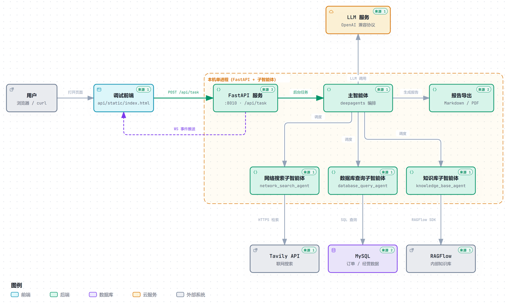
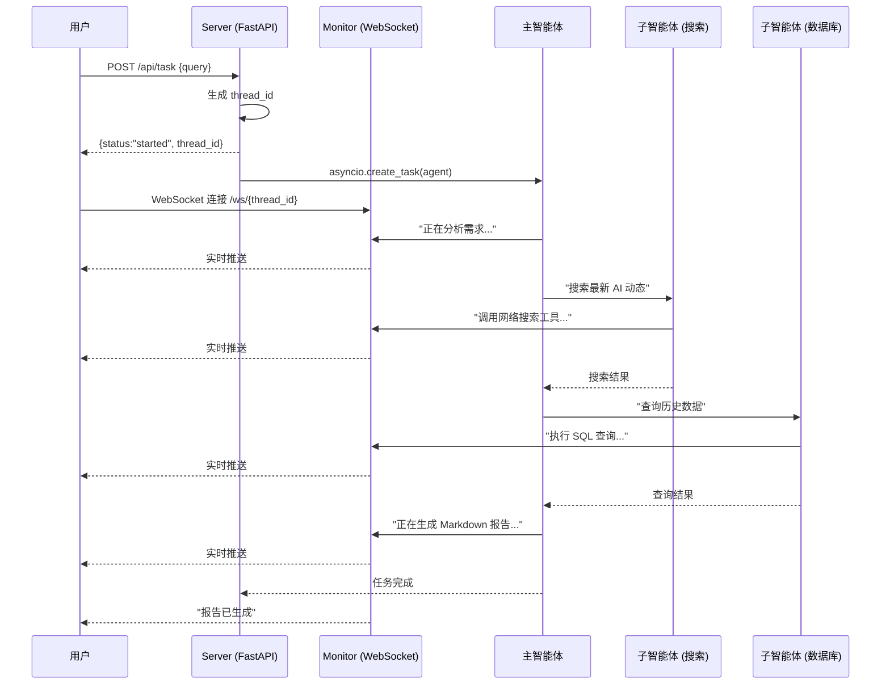

<p align="center">
  <h1 align="center">MultiAgent-Search</h1>
  <p align="center"><b>面向电商运营分析的多智能体协作系统 · 个人项目</b></p>
  <p align="center">
    
    
    
    
    
  </p>
</p>

---

## 项目简介

MultiAgent-Search 是我个人开发并维护的一个**多智能体协作分析系统**。它围绕电商运营里每天都会遇到的取数问题，把「查数据库、查内部资料、查外部信息」三件事收进同一个对话入口：

- **主智能体**：理解需求、拆解任务、决定调用哪些子智能体，最后汇总成 Markdown 报告；
- **网络搜索子智能体**：通过 Tavily 抓取外部信息（行业动态、竞品动作、消费者趋势）；
- **数据库查询子智能体**：把自然语言转成 SQL，查询 MySQL 中的订单与经营数据；
- **知识库子智能体**：在 RAGFlow 中检索内部 SOP、数据字典等文档；
- **Web 服务**：FastAPI 提供 HTTP 接口与 WebSocket 实时进度，浏览器页面可直接对话，报告可导出 PDF。

设计目标是「轻量、可读、可扩展」：核心链路约 1600 行 Python（含测试与评测脚本约 2500 行），单进程即可跑起来；MySQL、RAGFlow 都是可选项，缺任何一个系统会自动降级，而不是整体不可用。

> 项目定位：个人工具型项目，不是生产级 SaaS。优先保证链路完整、行为可观测、结果可复现，方便按需裁剪与继续扩展。

---

## 主要能力

| 能力 | 实现位置 | 说明 |
| --- | --- | --- |
| 多智能体编排 | `agent/main_agent.py` | 主智能体按需求调度 3 个子智能体，流式执行并汇总结果 |
| 实时进度推送 | `api/monitor.py` | WebSocket 事件总线，前端逐条看到「思考 / 工具调用 / 结果」 |
| 协程级会话隔离 | `api/context.py` | ContextVar 隔离并发请求的上下文，多会话互不串台 |
| 异步后台任务 | `api/server.py` | `POST /api/task` 立即返回 thread_id，任务用 `asyncio.create_task` 在后台执行 |
| NL2SQL + 只读守卫 | `tools/db_tools.py` | 自然语言查库；写操作、多语句、注释绕过都会被拦截 |
| 知识库检索 | `tools/ragflow_tools.py` | 封装 RAGFlow SDK，检索内部文档并返回引用 |
| 联网搜索 | `tools/tavily_tool.py` | Tavily 搜索，带超时重试与指数退避 |
| 文件读写安全 | `utils/path_utils.py` | 覆盖 12 类路径场景，拦截 `..` 越界与虚拟前缀 |
| 报告输出 | `tools/markdown_tools.py` / `tools/pdf_tools.py` | 生成 Markdown，可转 PDF（Windows 走 Word COM，Linux/容器可切 WeasyPrint） |
| 端到端评测 | `evals/run_eval.py` | 20 题、四类场景、确定性判分，结果可复现 |
| 持续集成 | `.github/workflows/ci.yml` | lint / syntax / test 三关并行，全绿后构建 Docker 镜像 |

---

## 架构

### 整体架构图



请求从调试前端进入，FastAPI 服务把任务交给主智能体；主智能体按需调度网络搜索、数据库查询、知识库三个子智能体，最后把结果汇总成 Markdown / PDF 报告，执行过程中的思考、工具调用与结果通过 WebSocket 实时回推前端。

### 一次请求的执行流程



### 数据流

1. 用户 `POST /api/task` 发自然语言请求；
2. 主智能体分析需求，决定调用哪些子智能体；
3. 子智能体各司其职 — 搜网络 / 查数据库 / 翻知识库；
4. 主智能体汇总信息，生成 Markdown 报告（可转 PDF）；
5. 全过程经 WebSocket 实时推送前端。

---

## 快速开始

### 环境要求

- **Python 3.12+**（依赖里的 `ragflow-sdk==0.23.1` 要求 ≥ 3.12，本地在 3.13 上验证）
- 一个 OpenAI 兼容的 LLM API Key（DeepSeek / 通义千问 / OpenAI 均可）
- Tavily API Key（[免费注册](https://tavily.com)，每月 1000 次额度）
- 可选：MySQL 8（订单数据）、RAGFlow（内部知识库）

> 数据库和 RAGFlow 是可选的，不配也能跑 — 主智能体会自动跳过没有的服务。

### 1. 克隆并安装

```bash
git clone https://github.com/scoffee16/Multiagent_search.git
cd Multiagent_search
pip install -r requirements.txt
```

### 2. 配置环境变量

```bash
cp .env.example .env
```

编辑 `.env`，最少填 4 个：

```env
OPENAI_BASE_URL=https://api.deepseek.com/v1
OPENAI_API_KEY=sk-xxxxxxxxxxxxxxxx
LLM_QWEN_MAX=deepseek-chat
TAVILY_API_KEY=tvly-xxxxxxxxxxxxxxxx
```

### 3. 启动

```bash
python api/server.py
```

- 浏览器访问 `http://127.0.0.1:8010` — 内置调试页面，支持多会话标签页；
- 访问 `http://127.0.0.1:8010/docs` 可用 Swagger 直接调 API；
- 服务监听 8010 端口。本地访问建议用 `127.0.0.1` 而不是 `0.0.0.0`，并把 `localhost;127.0.0.1;::1` 加入系统代理绕行列表，否则容易出现「终端没有请求日志、浏览器也打不开」的情况。

### 4. 试一试

```bash
curl -X POST http://127.0.0.1:8010/api/task \
  -H "Content-Type: application/json" \
  -d '{"query": "统计一下最近一批订单的品类占比"}'
```

WebSocket 实时进度：`ws://127.0.0.1:8010/ws/{返回的 thread_id}`

### HTTP 接口一览

| 方法 | 路径 | 说明 |
| --- | --- | --- |
| GET | `/` | 内置调试页面 |
| POST | `/api/task` | 提交任务（JSON: `{"query": "..."}`），返回 `thread_id` |
| POST | `/api/upload` | 上传文件到指定会话，供 Agent 读取 |
| GET | `/api/files` | 列出会话上传/生成的文件 |
| GET | `/api/download` | 下载生成的文件（Markdown / PDF） |
| WS | `/ws/{thread_id}` | 实时事件推送（思考、工具调用、结果、完成） |

### Docker 部署（可选）

```bash
cp .env.example .env        # 先填好配置
docker compose up -d        # 同时启动 MySQL 与应用
```

- `Dockerfile` 基于 `python:3.12-slim`，`docker-compose.yml` 里 MySQL 与应用各一个服务；
- Word COM（`pywin32`）仅在 Windows 可用，容器内 PDF 转换需改用 WeasyPrint；
- MySQL 容器把宿主 3307 映射到容器 3306（本机 3306 常被已有 MySQL 服务占用），初始化脚本为 `sql/init.sql`。

---

## 项目结构

```
Multiagent_search/
│
├── agent/                          # 智能体层（核心）
│   ├── llm.py                      # 模型初始化
│   ├── prompts.py                  # YAML 提示词加载器
│   ├── main_agent.py               # 主智能体 + 异步执行引擎
│   └── subagents/
│       ├── network_search_agent.py # 网络搜索子智能体
│       ├── database_query_agent.py # 数据库查询子智能体
│       └── knowledge_base_agent.py # 知识库子智能体
│
├── api/                            # Web 接口层
│   ├── server.py                   # FastAPI 入口 + 路由
│   ├── context.py                  # ContextVar 协程隔离
│   ├── monitor.py                  # WebSocket 连接池 + 埋点监控
│   └── static/index.html           # 前端调试页面
│
├── tools/                          # 工具函数（8 个 @tool）
│   ├── tavily_tool.py              # 网络搜索（含超时重试）
│   ├── db_tools.py                 # 数据库查询三件套
│   ├── ragflow_tools.py            # RAGFlow 知识库检索
│   ├── markdown_tools.py           # 生成 Markdown
│   ├── pdf_tools.py                # Markdown → PDF
│   └── upload_file_read_tool.py    # 读取上传文件
│
├── utils/                          # 工具层
│   ├── path_utils.py               # 路径安全解析
│   ├── retry.py                    # 指数退避重试装饰器
│   └── word_converter.py           # Word COM 引擎
│
├── prompt/prompts.yml              # 提示词配置
│
├── docs/
│   ├── kb/                         # 知识库示例文档（电商运营场景）
│   │   ├── 订单分析口径SOP.md       # GMV/订单数/客单价等指标口径
│   │   └── orders数据字典.md       # orders 表结构与枚举定义
│   └── images/architecture.png     # 架构图
│
├── evals/                          # 端到端评测
│   ├── dataset.json                # 20 题评测集（四类场景）
│   ├── run_eval.py                 # 评测脚本（HTTP + WebSocket 真实链路）
│   └── report*.md / report*.json   # 评测报告（首轮 + 最新一轮）
│
├── tests/                          # 单元测试
│   ├── test_monitor_events.py
│   ├── test_path_utils.py
│   └── test_sql_guard.py
│
├── scripts/                        # 运维 / 工具脚本
│   ├── ragflow_provision_demo.py   # RAGFlow 知识库初始化
│   ├── ragflow_upload_kb_docs.py   # 上传 docs/kb 文档
│   ├── ragflow_selfcheck_fill.py   # 知识库自检与补文档
│   ├── e2e_frontend_check.py       # 前端端到端自检
│   └── setup_ragflow_v0231.ps1     # RAGFlow 0.23.1 环境安装（Windows）
│
├── rawflow/                        # RAGFlow 原生 API 调用示例
├── sql/init.sql                    # MySQL 初始化（建表 + 演示数据）
│
├── .github/workflows/ci.yml        # CI：lint / syntax / test / docker
├── Dockerfile
├── docker-compose.yml
├── requirements.txt                # 依赖清单（版本锁定）
├── pyproject.toml                  # ruff 配置
├── pytest.ini
├── .env.example                    # 环境变量模板
└── LICENSE                         # MIT License
```

---

## 技术栈

| 层级 | 技术 | 说明 |
| --- | --- | --- |
| Agent 框架 | deepagents (LangChain 官方) | 多智能体编排 |
| 图编排 | LangGraph + AsyncSqliteSaver | 状态图 + 异步对话持久化 |
| LLM 接入 | LangChain + OpenAI 兼容协议 | 一套代码适配多种模型 |
| Web 框架 | FastAPI + Uvicorn | 异步 HTTP + 原生 WebSocket |
| 搜索引擎 | Tavily API | AI 专用搜索，免费额度 |
| 知识库 | RAGFlow | 开源 RAG 引擎 |
| 数据库 | MySQL | Agent 自动写 SQL（带只读守卫） |
| 文档生成 | Markdown + Word COM / WeasyPrint | MD 生成 + PDF 转换（Windows 走 Word） |
| 部署 | Docker / Docker Compose | 镜像构建 + 本地一键起服务 |

---

## 评测与测试

### 端到端评测（20 题 / 4 类）

`evals/dataset.json` 是 20 道题的评测集，覆盖查库、查文档、联网、综合四类；
`evals/run_eval.py` 走真实链路（HTTP 提交 + WebSocket 收事件）跑完打分，
判分用确定性关键词组，不引入 LLM 裁判，结果可复现、不额外花钱。

| 指标 | 结果 |
| --- | --- |
| 通过率 | **20/20（100%）**，四类各 5/5 |
| 延迟 | P50 **8.3s**，P95 28.2s，最大 28.4s |
| 工具调用 | 平均 **3.2 次/题**，最多 7 次 |
| 输出规模 | 平均 488 字（≈325 tokens，按中文 1.5 字/token 估算） |

复现方式：

```bash
python api/server.py                 # 另开一个窗口把服务起起来
python evals/run_eval.py             # 全量 20 题
python evals/run_eval.py --category 查库 --limit 3   # 只跑一部分
```

报告写入 `evals/report.md` / `evals/report.json`；首轮（18/20，查文档类因题集与智能体业务边界不匹配而失分）保存在 `evals/report-round1.md`，可与新报告对比。

> 已知局限：联网类 5 题模型直接凭参数化知识作答、没有触发 Tavily 工具（`tool_calls=0`），
> 因此该类别证明的是「答得对」，不代表「联网链路被验证过」。

### 单元测试

```bash
pytest -q      # 53 passed
```

| 测试文件 | 覆盖内容 |
| --- | --- |
| `tests/test_monitor_events.py` | 事件总线 6 类事件的 payload、时间戳、无 runtime/无 WS 时降级 |
| `tests/test_path_utils.py` | 虚拟前缀清洗、session 嵌套防护、updated/ 重定向、`..` 越界拦截 |
| `tests/test_sql_guard.py` | SQL 只读守卫：写操作、多语句、关键字出现在字面量里的误判 |

### CI

`.github/workflows/ci.yml` 三个检查关（lint / syntax / test）并行跑，全绿后才构建 Docker 镜像。
lint 分两道闸：全仓只拦 E9/F63/F7/F82 这类真错误，新代码（`tests/`、`evals/`）按全量规则 + 格式化严格执行。

---

## Roadmap

- [x] 多智能体主链路（主智能体 + 3 个子智能体）与 WebSocket 实时进度
- [x] 20 题端到端评测集与确定性判分脚本
- [x] SQL 只读守卫、路径越界防护、单元测试与 CI 四关
- [x] Dockerfile / docker-compose 本地一键部署
- [ ] JWT 登录与多用户配额
- [ ] 人工审批节点（LangGraph interrupt），敏感操作需确认
- [ ] 报告归档与会话历史管理
- [ ] 前端从单文件调试页重构为独立应用
- [ ] 全平台 PDF 转换（去掉 Word COM 依赖）

---

## 已知限制

- 联网类评测中模型可能凭参数化知识直接作答，`tool_calls=0`，该类别不能证明联网链路被验证过；
- PDF 转换在 Windows 下依赖 Word COM，容器内需要 WeasyPrint 替代；
- 当前没有鉴权与多租户配额，默认按单机单用户使用设计；
- 评测集 20 题，用于回归验收，不等同于全面质量评估。

---

## License

MIT License — 随意使用、修改、分发。

作者：scoffee16 ｜ 仓库：[scoffee16/Multiagent_search](https://github.com/scoffee16/Multiagent_search) ｜ 欢迎 Issue / PR。
